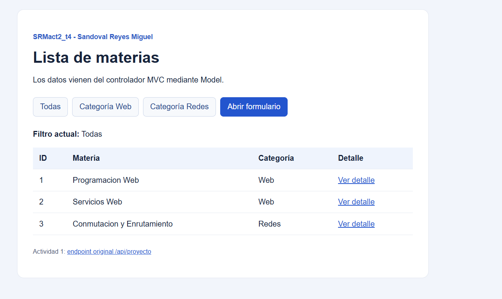
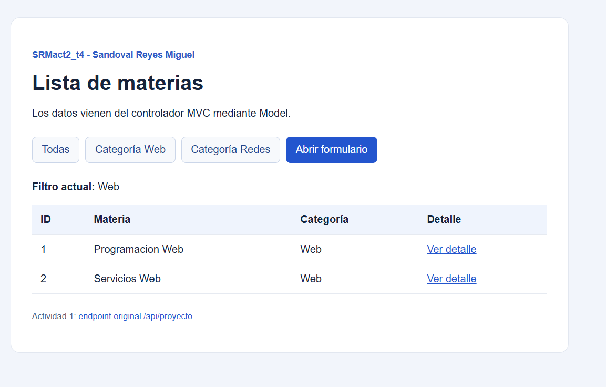
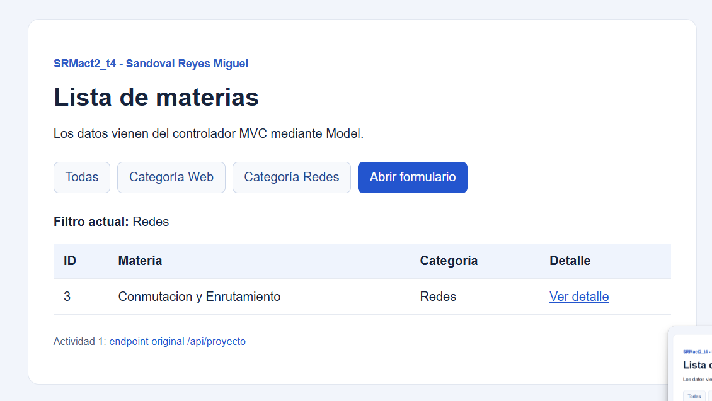
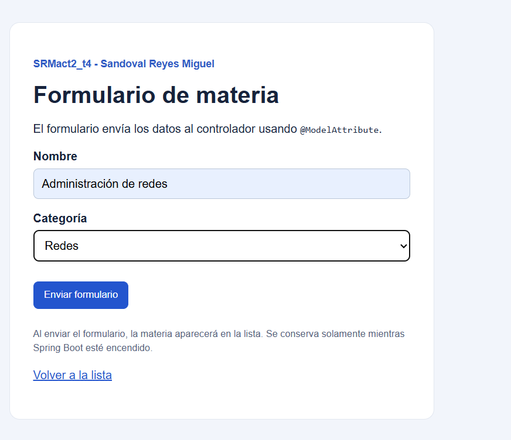
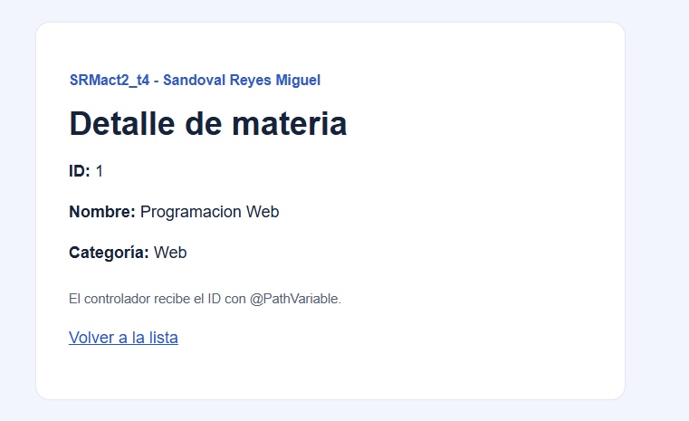
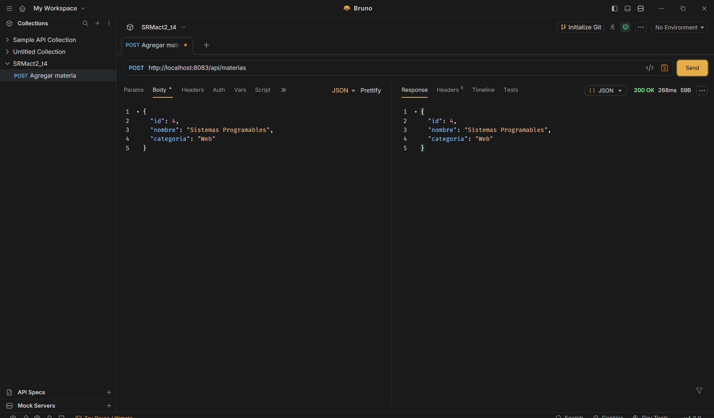

# SRMact2_t4 — Spring MVC, Thymeleaf y DTOs

**Autor:** Sandoval Reyes Miguel.  
**Asignatura:** Programación Web · Tema 4  
**Tecnologías:** Java 17, Spring Boot 4.1.0, Spring MVC, Thymeleaf, Gradle, HTML y CSS.

## Descripción

Aplicación web desarrollada con Spring Boot que combina **vistas MVC renderizadas con Thymeleaf** y **endpoints REST que intercambian JSON**. El proyecto parte de una copia independiente de `SRMact1_t4`: conserva sus tres endpoints GET y agrega navegación entre materias, filtros por categoría, consulta por ID y un formulario de registro.

Los datos se manejan mediante objetos `MateriaDTO`. La aplicación no requiere una base de datos: las materias agregadas desde el formulario se mantienen **temporalmente en memoria** mientras el servidor está en ejecución.

## Aplicación en línea

- **Listado de materias:** http://167.99.15.140:9082/materias
- **Filtro Web:** http://167.99.15.140:9082/materias?categoria=Web
- **Filtro Redes:** http://167.99.15.140:9082/materias?categoria=Redes
- **Formulario:** http://167.99.15.140:9082/materias/nueva
- **Detalle de ejemplo:** http://167.99.15.140:9082/materias/1

La aplicación MVC utiliza el **puerto 9082**. El proyecto `SRMact1_t4` permanece como una aplicación independiente en el **puerto 8082**: http://167.99.15.140:8082/api/proyecto.

## Funcionalidades

- **Listado de materias:** `MateriasMvcController` envía la colección a la vista mediante `Model`; Thymeleaf genera las filas con `th:each`.
- **Filtro por categoría:** `@RequestParam` lee el parámetro `categoria` de la URL para mostrar materias de Web o Redes.
- **Consulta por ID:** `@PathVariable` obtiene el identificador de la URL y muestra la información en `detalle.html`.
- **Formulario MVC:** `@ModelAttribute` recibe los campos del formulario como un `MateriaDTO`. Se asigna un ID automáticamente, se agrega la materia a la lista en memoria y se redirige al listado.
- **Configuración:** `@Value` obtiene `proyecto.nombre` desde `application.properties` y lo presenta en las vistas.
- **API REST:** `@RequestBody` convierte el JSON de una petición POST en un `MateriaDTO` y devuelve el objeto como JSON.

## Rutas disponibles

| Método | Ruta | Descripción |
| --- | --- | --- |
| `GET` | `/materias` | Listado completo con Thymeleaf. |
| `GET` | `/materias?categoria=Web` | Filtra las materias de Web. |
| `GET` | `/materias?categoria=Redes` | Filtra las materias de Redes. |
| `GET` | `/materias/{id}` | Muestra el detalle de una materia. |
| `GET` | `/materias/nueva` | Muestra el formulario de registro. |
| `POST` | `/materias/guardar` | Recibe el formulario y agrega una materia a la lista en memoria. |
| `POST` | `/api/materias` | Recibe un DTO en JSON y devuelve una respuesta JSON. |
| `GET` | `/api/proyecto` | Endpoint REST conservado del proyecto anterior. |
| `GET` | `/api/materias` | Lista REST de ejemplo conservada del proyecto anterior. |
| `GET` | `/api/total-materias` | Total de materias de la lista REST original. |

**Nota sobre los datos:** el formulario modifica la lista utilizada por las vistas MVC. Los endpoints GET REST heredados mantienen su propia lista de ejemplo; el POST REST devuelve los datos recibidos, pero no agrega registros a ninguna lista. Las materias creadas mediante el formulario se pierden al reiniciar Spring Boot.

## Estructura del proyecto

```text
src/main/
├── java/com/srm/actividad1/
│   ├── Actividad1Application.java
│   ├── controller/
│   │   ├── ProyectoController.java
│   │   ├── MateriasController.java
│   │   ├── MateriasMvcController.java
│   │   └── MateriaPostController.java
│   └── dto/
│       └── MateriaDTO.java
└── resources/
    ├── application.properties
    ├── templates/
    │   ├── materias.html
    │   ├── formulario.html
    │   └── detalle.html
    └── static/
        └── estilos.css
```

## Ejecución local

Se necesita **JDK 17 o posterior compatible**. El proyecto incluye Gradle Wrapper, por lo que no hace falta instalar Gradle por separado.

En **Windows**, desde la raíz del proyecto:

```cmd
.\gradlew.bat bootRun
```

En **Linux**:

```bash
./gradlew bootRun
```

La configuración principal se encuentra en `src/main/resources/application.properties`:

```properties
spring.application.name=SRMact2_t4
server.port=9082
proyecto.nombre=SRMact2_t4 - Sandoval Reyes Miguel
```

Una vez iniciada la aplicación, abrir http://localhost:9082/materias. Para detenerla, presionar `Ctrl + C` en la terminal.

Para generar el archivo ejecutable en Windows:

```cmd
.\gradlew.bat bootJar
```

El JAR se genera en `build/libs/SRMact2_t4-0.0.1-SNAPSHOT.jar`.

## Ejemplo de petición POST con Bruno

**Método:** `POST`  
**URL local:** `http://localhost:9082/api/materias`  
**Encabezado:** `Content-Type: application/json`

Cuerpo de la petición:

```json
{
  "id": 4,
  "nombre": "Sistemas Programables",
  "categoria": "Web"
}
```

El servidor responde con **HTTP `200 OK`** y el mismo objeto en formato JSON. Esta operación demuestra el uso de `@RequestBody`; no guarda el registro en una base de datos ni modifica el listado MVC.

## Capturas de pantalla

### Listado completo de materias

La vista recibe los datos mediante `Model` y los muestra en una tabla utilizando `th:each`.



### Filtro por categoría Web

Consulta de materias con `@RequestParam` y el valor `categoria=Web`.



### Filtro por categoría Redes

Consulta de materias con `@RequestParam` y el valor `categoria=Redes`.



### Formulario de materias

Prueba de recepción de campos HTML mediante `@ModelAttribute` y `MateriaDTO`.



### Detalle de una materia

Consulta del identificador mediante `@PathVariable`.



### Prueba de la API REST en Bruno

Envío de un objeto JSON al endpoint `POST /api/materias` y respuesta satisfactoria con código `200 OK`.



*Las capturas corresponden a pruebas realizadas durante el desarrollo. La versión actual de la aplicación utiliza el puerto 9082 y asigna automáticamente el ID al guardar desde el formulario.*
